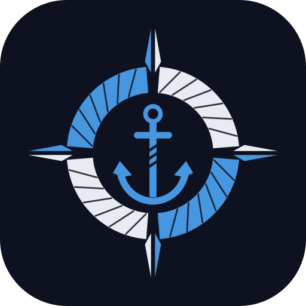
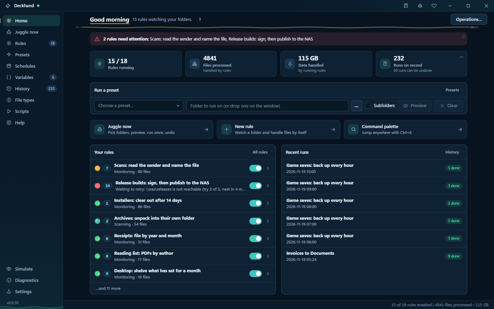
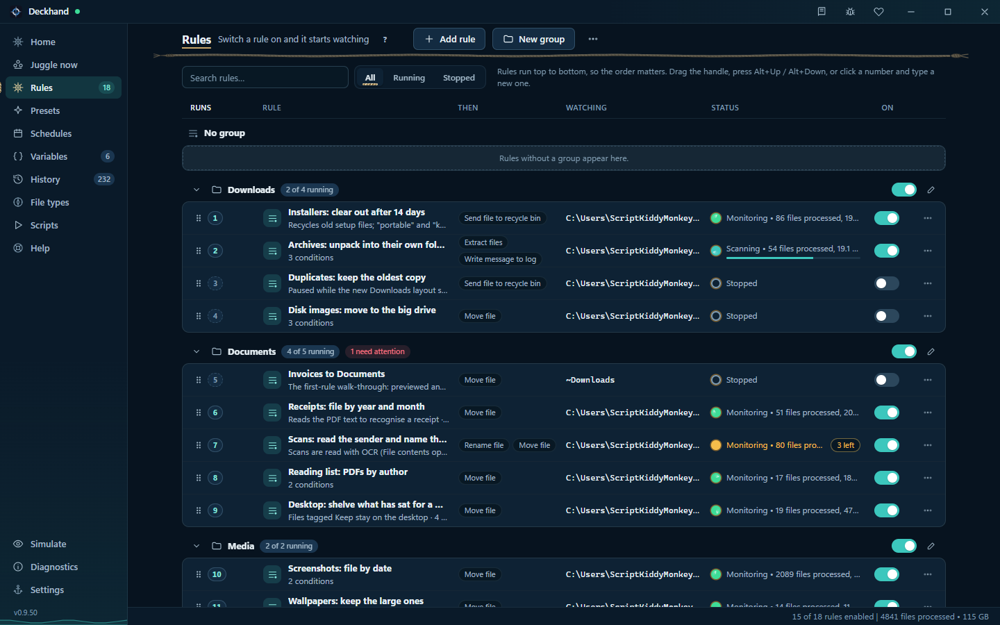
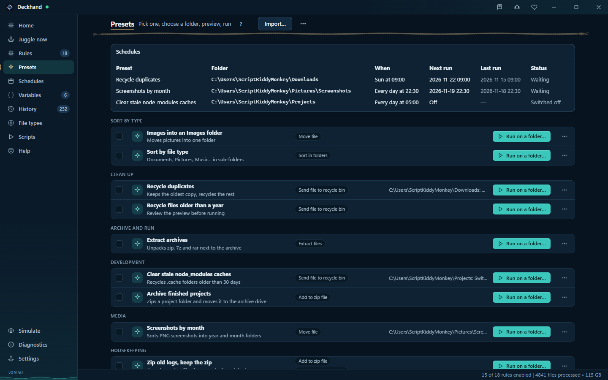
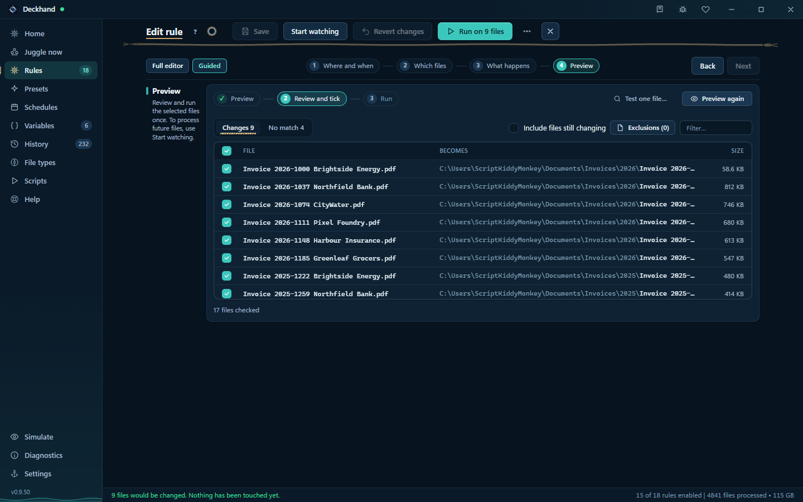
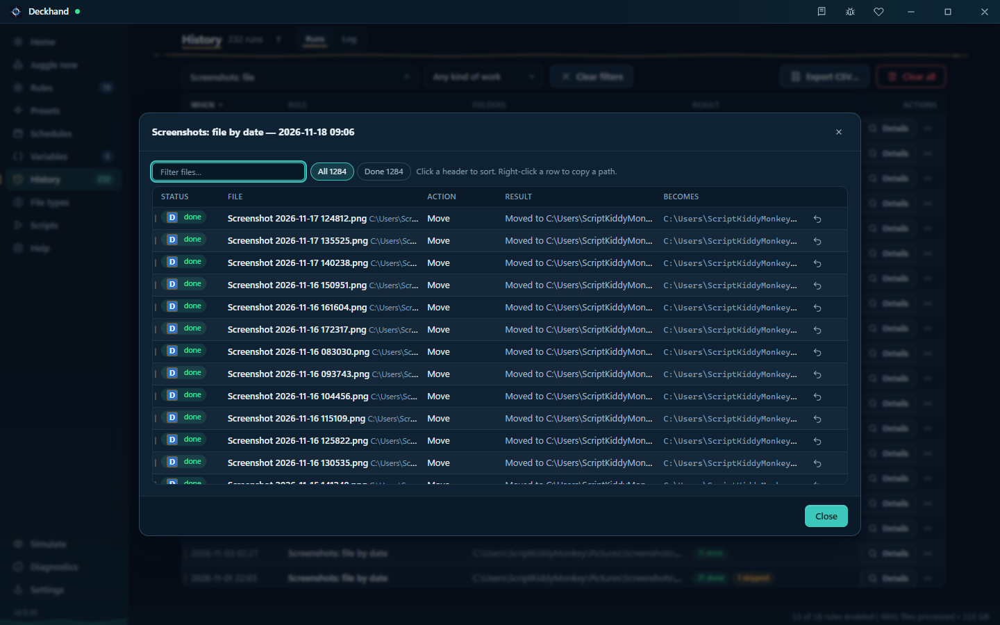
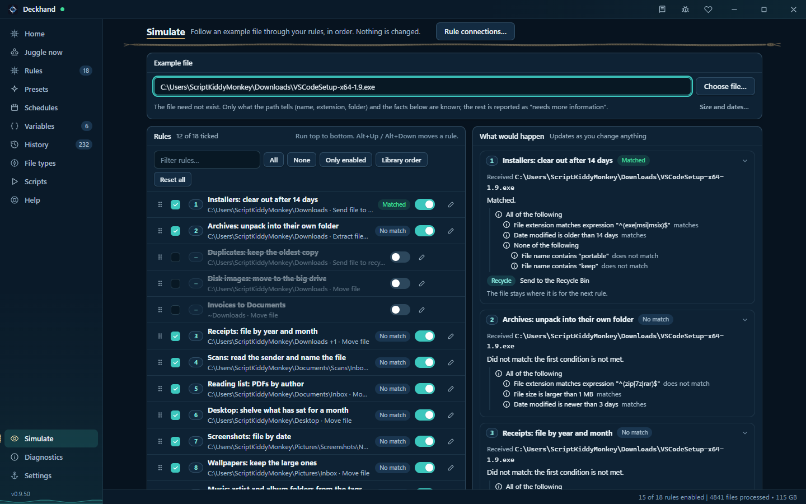
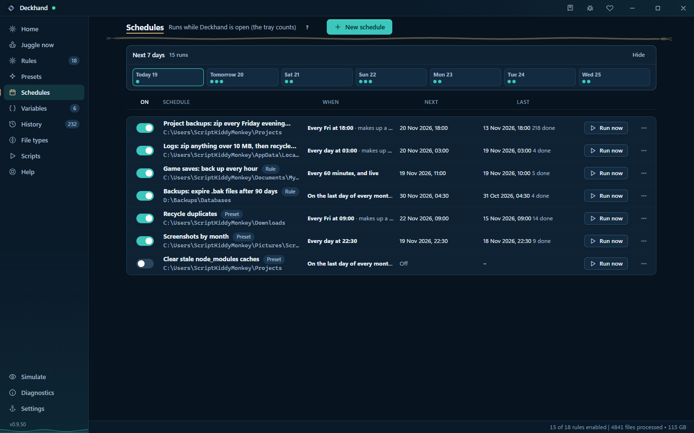

  

<h1 align="center">Deckhand</h1>

<strong>Put your files to work.</strong> A rule-based file organiser for Windows. Preview first, undo afterwards.

  <a href="https://apps.microsoft.com/detail/9p5314gfs8s6">Get it from Microsoft Store</a> ·
  <a href="https://github.com/AuZzii-Xssistant/Deckhand/releases/latest/download/Deckhand.exe">Download from GitHub</a> ·
  <a href="https://auzzii-xssistant.github.io/Deckhand/">Website</a> ·
  <a href="https://auzzii-xssistant.github.io/Deckhand/docs/index.html">Docs</a> ·
  <a href="https://github.com/AuZzii-Xssistant/Deckhand/issues/new/choose">Report an issue</a>

  

Deckhand watches folders and applies rules you define. Sort Downloads, rename invoices using their contents, file photos by date, clear out old installers. Preview the changes before a manual run, then use History to review the result and undo supported actions.

## How it works

1. **Pick a folder to watch.** Downloads, a scan folder, a project folder, a network share.
2. **Say which files and what to do.** Match by name, type, size, dates, metadata or file contents, then move, copy, rename, compress, extract, tag or send to the Recycle Bin.
3. **Preview, then run.** A preview lists every file and where it would go. You tick what you want, run it, and History keeps a record you can undo.

Rules can also run in the background (with a tray icon), on a schedule, or on demand through presets.

## What you can do

- **Watch and schedule.** Run rules in the background, on a schedule, or manually. Use presets for repeatable jobs on folders you choose.
- **Match and organise.** Filter by name, type, dates, size, metadata (documents, audio, photos) or file contents. Optional text recognition (OCR) reads images and scans. Find duplicates and keep one copy.
- **Name things properly.** Variables and transforms build names and folders from a file's own details.
- **Review and recover.** Preview before a manual run, inspect History and the log, and undo actions Deckhand can reverse. Overwritten files go to the Recycle Bin.
- **Try without risk.** **Simulate** follows an example file through your rules in order without touching anything.
- **Stay in control.** Protected folders, skip-hidden and skip-system options, exclusions, and confirmations before anything destructive.
- **Reuse and automate.** Export rules and presets, back up your library, use the optional Explorer right-click menu, or run rules from the command line.
- **Work with an AI assistant.** Optional: let a local MCP client draft rules for you. Drafts arrive switched off, and runs started that way still need your confirmation on the desktop.

## Screenshots

The screenshots use sample data. The appearance may vary by release.

| Rules | Presets |
| --- | --- |
|  |  |
| **Preview and run** | **History and undo** |
|  |  |
| **Simulate** | **Schedules** |
|  |  |

More screens, including all four themes, are in the [screenshot gallery](https://auzzii-xssistant.github.io/Deckhand/screenshots/index.html).

## Get started

Install from the [Microsoft Store](https://apps.microsoft.com/detail/9p5314gfs8s6) for automatic updates, or use the free portable GitHub build:

1. Use **64-bit Windows 10 or 11** with the **Microsoft Edge WebView2 Runtime**. If the runtime is missing, install the [WebView2 Evergreen Runtime from Microsoft](https://developer.microsoft.com/en-us/microsoft-edge/webview2/#download-section).
2. Download **Deckhand.exe** from [GitHub Releases](https://github.com/AuZzii-Xssistant/Deckhand/releases/latest). Each release provides a SHA-256 checksum.
3. Run the executable from a folder you intend to keep. Deckhand ships as a single standalone file, with no installer.
4. Start with a test folder, create a rule, press **Preview**, and check the proposed destinations before you run it. The [first rule guide](https://auzzii-xssistant.github.io/Deckhand/docs/first-rule.html) walks through it.

> **Unsigned GitHub download.** The portable executable is not code-signed. Windows SmartScreen may show an unknown-publisher or unrecognised-app warning. Verify the download against the release checksum before deciding whether to run it.

Deckhand is in beta. Keep backups of important files, especially before trying rules that delete or overwrite.

## Your files stay on your PC

Deckhand has no account, no analytics and no telemetry, and it does not upload your files, rules or history. Everything is stored locally. Read the full [privacy policy](https://auzzii-xssistant.github.io/Deckhand/privacy.html).

## Documentation

- [Online docs](https://auzzii-xssistant.github.io/Deckhand/docs/index.html): install, first rule, conditions, actions, variables, Simulate, command line, troubleshooting
- [Connect a local AI client with MCP](https://auzzii-xssistant.github.io/Deckhand/docs/mcp.html)
- [Rules, previews and diagnostics](docs/WORKFLOWS.md)
- [AI rule authoring guide](docs/AI-AUTHORING.md), [worked examples](docs/AI-AUTHORING-EXAMPLES.md), and [draft schema](docs/deckhand-draft.schema.json)

## Support and licence

Use the bug report or feature request form. Remove personal file paths or names from any screenshots you attach. [Open an issue](https://github.com/AuZzii-Xssistant/Deckhand/issues/new/choose)

This public repository hosts Deckhand's compiled releases, screenshots, and documentation. The application source is private. Deckhand is free for personal and commercial use under the [Deckhand licence](LICENSE).
