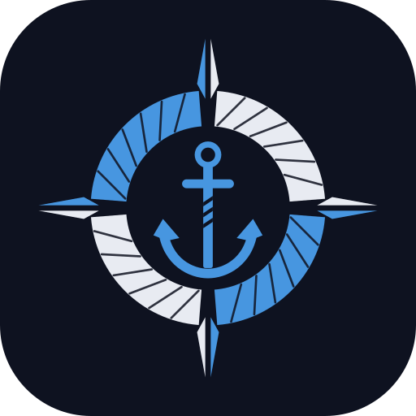
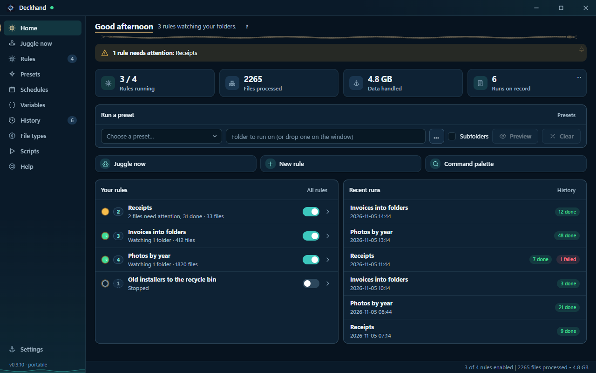
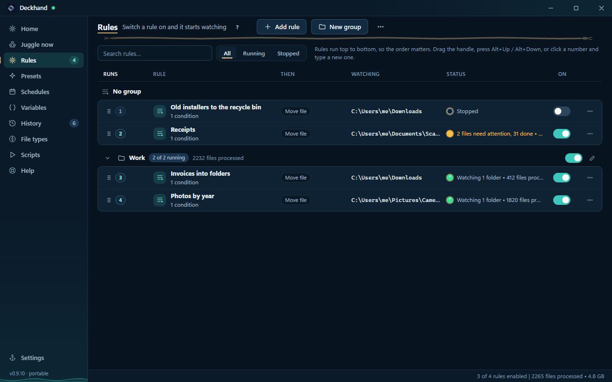
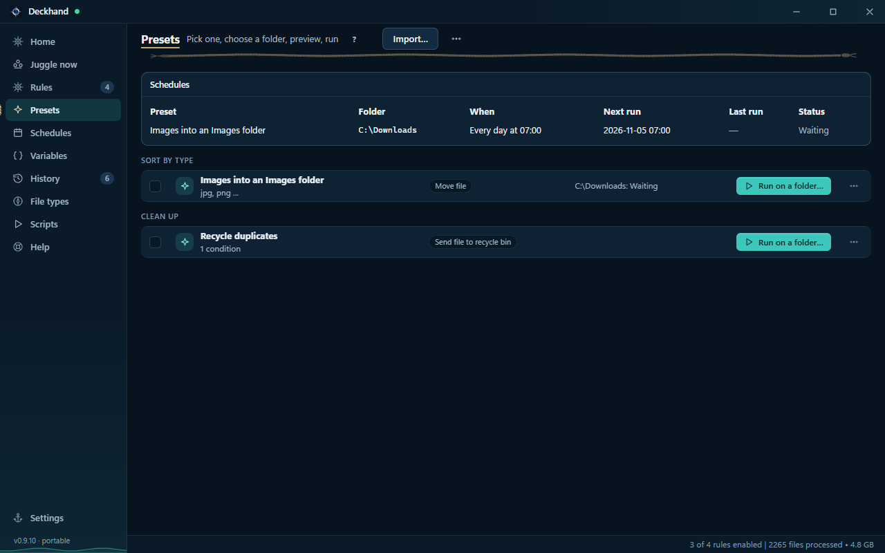
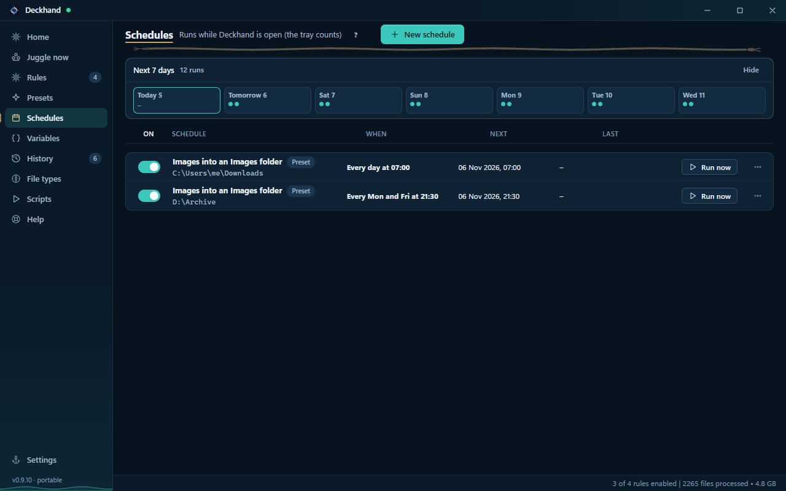
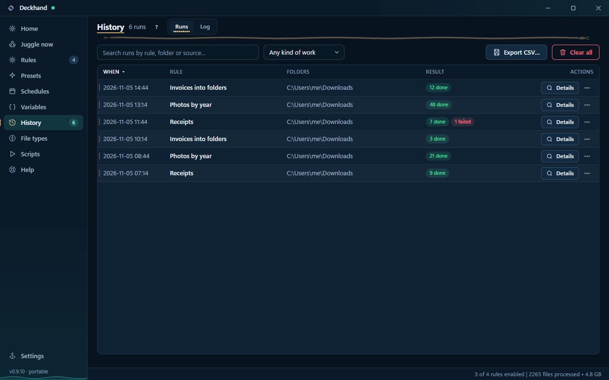

  

<h1 align="center">Deckhand</h1>

A Windows file organiser for the folders you keep sorting by hand.

  <a href="https://auzzii-xssistant.github.io/Deckhand/">Website</a> ·
  <a href="https://github.com/AuZzii-Xssistant/Deckhand/releases/latest">Download for Windows</a> ·
  <a href="https://github.com/AuZzii-Xssistant/Deckhand/issues">Report an issue</a>

Deckhand watches folders and applies rules you define. Sort Downloads, rename invoices using their contents, or file photos by date. Preview the changes before a manual run, then use History to review the result and undo supported actions.

## Get started

1. Use **64-bit Windows 10 or 11** with the **Microsoft Edge WebView2 Runtime**. If the runtime is missing, install the [WebView2 Evergreen Runtime from Microsoft](https://developer.microsoft.com/en-us/microsoft-edge/webview2/#download-section).
2. Download **Deckhand.exe** from [GitHub Releases](https://github.com/AuZzii-Xssistant/Deckhand/releases/latest). The release also provides a SHA-256 checksum.
3. Run the executable from a folder you intend to keep. Deckhand ships as a standalone executable. Start with a test folder, preview a rule, and check the proposed destinations before running it.

> **Unsigned Windows executable.** Deckhand is currently distributed without a code-signing signature. Windows SmartScreen may show an unknown-publisher or unrecognised-app warning. Verify the download against the release checksum before deciding whether to run it.

Deckhand is in beta. Keep backups of important files, especially before trying rules that delete or overwrite.

## What you can do

- **Watch and schedule.** Run rules in the background, on a schedule, or manually. Use presets for repeatable jobs on folders you choose.
- **Match and organise.** Filter by name, type, dates, metadata, or file contents. Move, copy, rename, sort, archive, and extract files.
- **Review and recover.** Preview proposed actions, inspect the History and log after a run, and undo actions that Deckhand can reverse.
- **Reuse your setup.** Export rules and presets or back up your library. Deckhand also offers an optional Explorer right-click menu and command-line controls.

## Screenshots

The screenshots use sample data. The appearance may vary by release.

| Rules | Presets |
| --- | --- |
|  |  |
| **Schedules** | **History** |
|  |  |

## Support and licence

For bug reports, include your Deckhand version, the Windows version, what you expected, and what happened. Remove personal file paths or names from any screenshots you attach. [Open an issue](https://github.com/AuZzii-Xssistant/Deckhand/issues)

This public repository hosts Deckhand's compiled releases, screenshots, and documentation. The application source is private. Deckhand is free for personal and commercial use under the [Deckhand licence](LICENSE).
